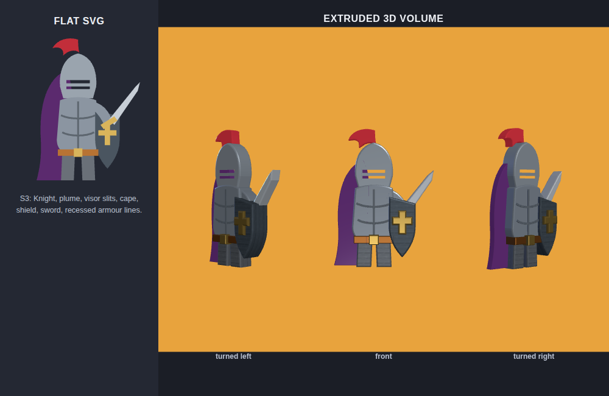
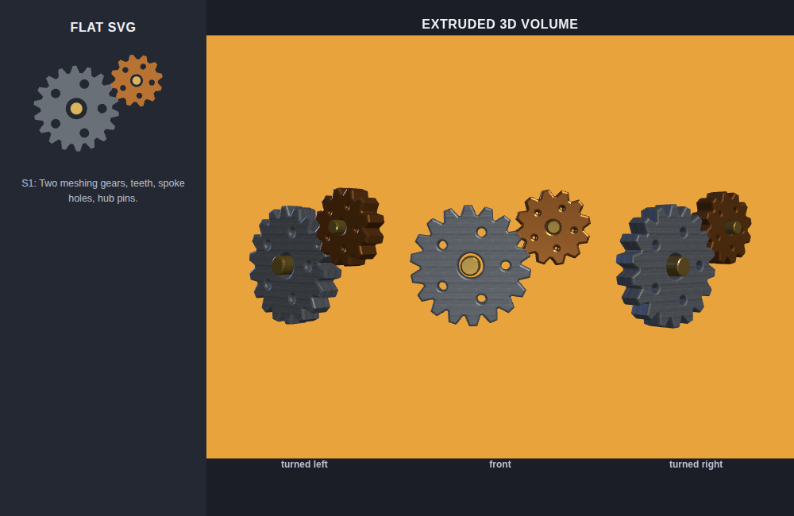
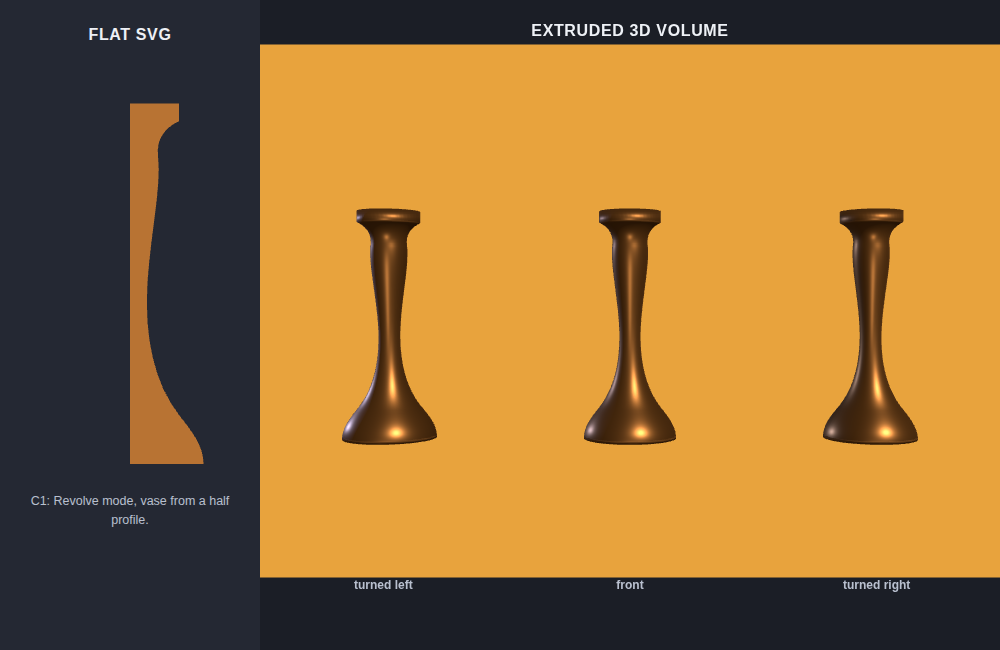
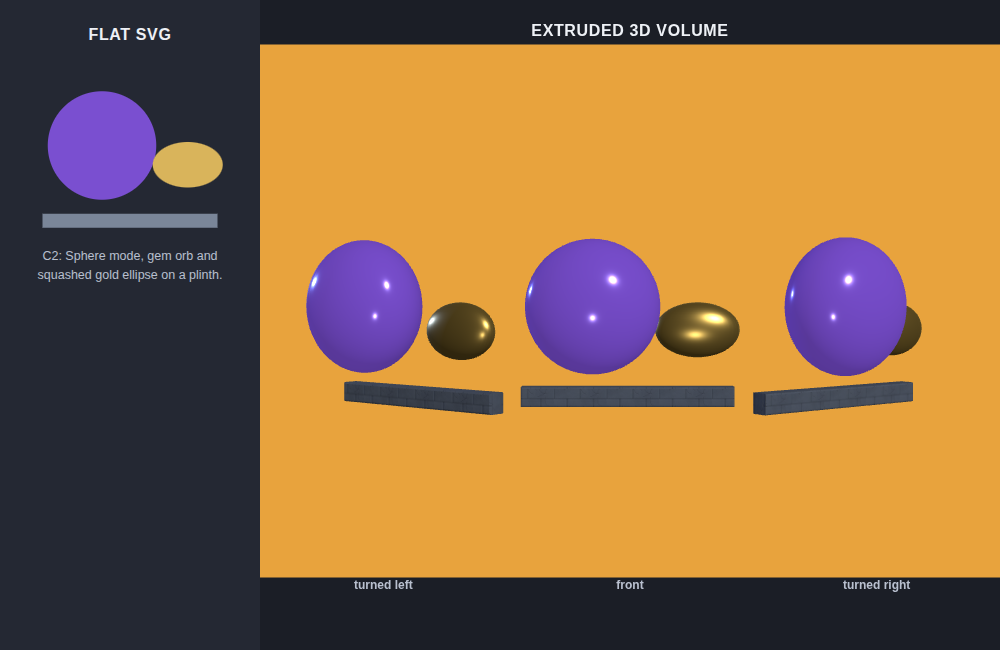
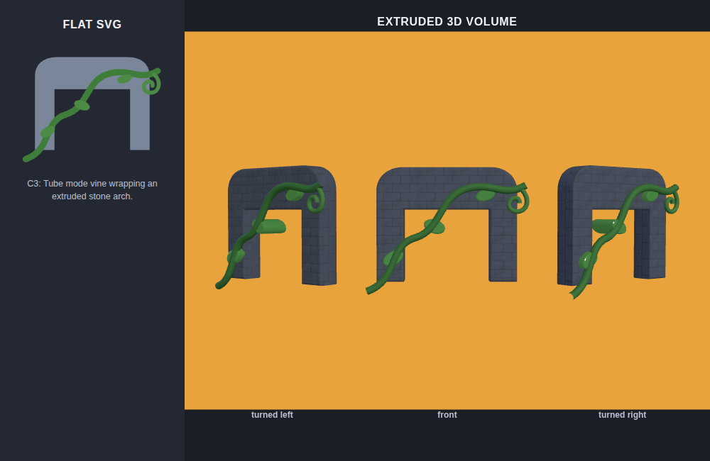
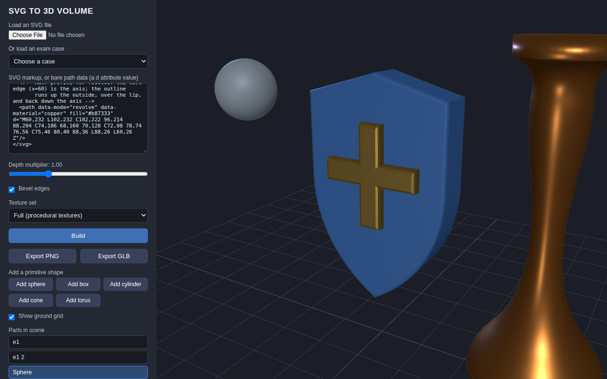

# SVG to 3D Volume Tool

Turns a flat 2D SVG design into a real 3D object in the browser:
extruded volume, bevels, real see-through holes, layered and recessed
parts, raised emblems, procedural textures, and exportable output.
Built for the TTRPGAI token and prop library, and for general
2D-to-3D objects for games and scenes.

No build step, no server-side code, no image generation, no external
image files. All textures are drawn on canvas in code.

## Gallery

Knight with engraved breastplate lines, gears with spoke holes, a
revolved vase, sphere-mode orbs, a tube vine, and a composed scene:

The prompts that built this tool, and prompts for authoring SVGs for
it, are in [PROMPTS.md](PROMPTS.md).

## Run it

Serve this folder over HTTP (module scripts do not load from file://):

    cd ~/workspace/svg-to-3d-tool
    python3 -m http.server 8901

Then open http://127.0.0.1:8901/index.html

## Usage

1. Load an SVG one of three ways:
   - Choose an .svg file.
   - Paste SVG markup into the text box.
   - Paste bare path data (a `d` attribute value, for example
     `M20,20 L100,20 L100,100 L20,100 Z`) into the text box.
2. Set options and press Build:
   - Depth multiplier (0.25 to 3) scales every layer depth.
   - Bevel edges on or off.
   - Texture set: full procedural textures, or flat colours.
3. Orbit the result with the mouse (drag to rotate, wheel to zoom).
4. Export PNG saves a render of the current view. Export GLB saves a
   binary glTF model that loads in Three.js, Blender, and game engines.

## Layer control inside the SVG

Add these attributes to any path, shape, or group (groups pass them
down to children):

- `data-depth="34"` extrusion depth in SVG units for that element.
  Default is 20. Deeper elements protrude from shallower ones, which
  is how raised emblems are made.
- `data-material="gold"` one of: steel, gold, copper, iron, gem,
  wood, stone, metal. Without it, the element fill colour is used.
  Without a fill, the SVG default applies (a neutral grey is used
  instead of spec black so pasted shapes read clearly).
- `data-role="recessed"` has two forms. On a filled element it centres
  the element inside the depth of the base layers instead of extruding
  it from the back face; this is how the portcullis sits inside the
  castle gate doorway. On a stroke element (engraved detail lines) it
  instead places the line on the front surface of the solid part it is
  drawn over, sitting slightly proud so it reads as engraving. Other
  roles (base, raised) extrude from the back face as usual.
- Holes: draw the hole as a subpath inside the same path as its solid
  and set `fill-rule="evenodd"` on the path. Overlapping holes (a
  keyhole made of a circle plus a slot) are merged automatically.
- Stroke-only artwork (lines with a stroke and no fill) is given
  volume: each segment becomes a bar of the stroke width.

## Build modes: more than extrusion

Set `data-mode` on an element (or a group) to build it another way.
Without it, everything extrudes as above.

- `data-mode="revolve"` on a filled element: the element outline is
  treated as a half profile and spun around the vertical line at its
  left edge, making a true solid of revolution (vases, pawns, bottles,
  candlesticks). Draw only the half profile, with its left edge on the
  axis.
- `data-mode="sphere"` on a filled element: the element becomes a
  sphere scaled to its bounding box, with `data-depth` as its z
  diameter. A circle makes a ball; an ellipse makes a squashed orb.
- `data-mode="tube"` on a stroke-only element: the stroke becomes a
  round tube following the path (ropes, vines, handles), riding on the
  front surface of the design. Radius is half the stroke width.

Using a mode on the wrong kind of element warns and falls back to
extrusion.

## Scene building in the app

The app is a small scene builder, not just a viewer. Every SVG you
load becomes a part in the scene; loading more adds more parts. You
can also add primitive parts (sphere, box, cylinder, cone, torus).
Select a part in the parts list to move it (X/Y sliders), rotate it,
scale it, recolour it, duplicate it, or delete it. A ground grid
helps placement and can be toggled off. Export PNG and Export GLB
save the whole composed scene.

## Exam and verification

exam/EXAM.md is the frozen judging exam (frozen before the tool was
written, hashes in exam/HASHES.txt): 8 cases from a simple shield to a
stroke-only snowflake and an adversarial mix. exam/LEDGER.md records
every version, its one lever, and its per-case results.

Final state: all 8 cases pass all gates (recognisable, real depth,
see-through holes, texture reads, no broken geometry, clean silhouette
at 3 angles), renders in renders/ (e1-v1, e2-v4, e3-v4, e4-v1, e5-v1,
e6-v2, e7-v1, e8-v1 plus full reports). GLB export was validated by
parsing the exported file back with a glTF loader: mesh and triangle
counts match the source exactly. PNG and GLB export buttons were
verified with real downloads.

To re-run the exam capture: start the HTTP server, then
`~/workspace/tools-venv/bin/python capture.py v5` (any tag).

Open index.html?exam=e3 in a browser to see any single case as a
three-angle strip against an amber backdrop (the backdrop is what
shows through real holes).

## Limits, stated honestly

- Elements handled: path, rect, circle, ellipse, line, polyline,
  polygon. Text elements, images, and use references are not
  converted; lettering must be drawn as paths (see exam case E4).
- Gradients and patterns are ignored; the flat fill colour is used.
- A hole that pokes outside its solid is dropped with a warning
  rather than corrupting the whole shape.
- Open paths are auto-closed with a warning.
- Stroke joins are overlapping bars, not true mitered outlines, so
  angled views of stroke art look chunkier than the front view.
- Self-intersecting outlines may triangulate imperfectly.
- Very small details survive (the exam includes a 4-unit star) but
  bevel is clamped on tiny shapes so they are not destroyed by it.

## Files

- index.html: the app, plus the exam harness mode (?exam=e1 to e8).
- src/svg3d.js: the converter. `buildFromSVG(svgText, options)`
  returns { group, warnings, stats }.
- src/textures.js: procedural wood, brushed metal, and stone
  textures (colour map plus bump map each), seeded so renders are
  stable.
- lib/: Three.js r160 and the addons used (SVGLoader, OrbitControls,
  GLTFExporter, GLTFLoader), vendored locally.
- capture.py: headless exam capture harness.
- glb-test.html: GLB export parse-back test page.
